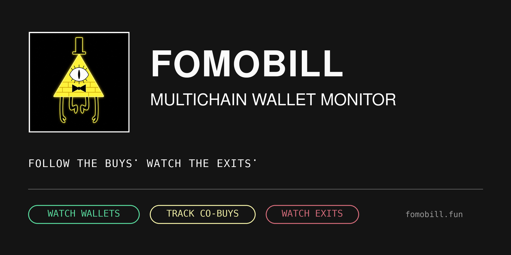
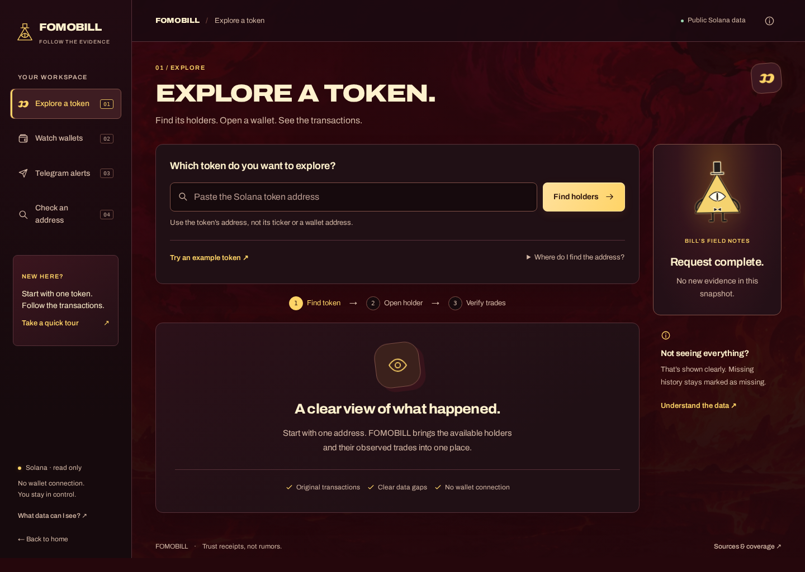

<p align="center">
  
</p>

<p align="center">
  <strong>Follow the buys. Watch the exits.</strong><br>
  Explore Solana holders, inspect transaction receipts, and bring selected wallets into your Telegram watch flow.
</p>

<p align="center">
  <a href="https://fomobill.fun"><strong>Open App</strong></a> &nbsp; · &nbsp;
  <a href="https://t.me/fomobill_bot"><strong>Telegram Bot</strong></a> &nbsp; · &nbsp;
  <a href="https://api.fomobill.fun/workspace/"><strong>Backend Workspace</strong></a> &nbsp; · &nbsp;
  <a href="docs/setup.md"><strong>Run locally</strong></a>
</p>

---

## From a token to the wallets behind it

**01 — Find the holders**
Paste an exact Solana token address. Explore the available holder sample, search and sort locally, and open a wallet without hunting for addresses first.

**02 — Read the receipts**
Inspect supported buys and sells with timestamps, quantities and transaction links. Load more history explicitly; unavailable data stays unavailable, not a fabricated zero.

**03 — Choose what to watch**
Select wallets and confirm monitoring. Review observed co-buys and subsequent participant sales, with evidence and bounded-coverage context.

**04 — Take it to Telegram**
Pair your browser watchlist, confirm `/subscribe`, and receive supported event alerts. Sale alerts have their own opt-in. No wallet connection, private keys or trade execution.

## The workspace



*Actual local workspace from this repository, before a token lookup. No sample trading activity is presented as live data.*

| Surface | What it does |
| --- | --- |
| Token research | Exact-token market lookup and a market-chart integration |
| Holder explorer | Available holder sample, local filtering/sorting and wallet drill-down |
| Receipt history | Supported Solana transaction decoding with explicit pagination |
| Monitor | Consent-based wallet selection, observed co-buy groups and participant sales |
| Telegram | Pairing, subscription controls, event notifications and the branded `/start` card |

### Coverage, without the fine print

**This release supports Solana only.** “Multichain” on the brand card is a product descriptor, not implemented EVM or other-chain coverage.

Holder-history decoders cover supported Pump, PumpSwap, Raydium and Orca receipt formats; they do not decode every transaction. The monitoring collector has its own narrower Pump coverage. A holder snapshot is not a complete wallet history, and current holders omit wallets that fully exited. No observed matches is not proof of no trading. This is a research and notification tool—not a trading bot, PnL engine or investment recommendation.

## Run it yourself

Python **3.10+**. Standard library only—no Python packages to install.

```sh
git clone https://github.com/immortalhowwl/fomobill.git
cd fomobill
HOST=127.0.0.1 PORT=8080 DATA_DIR="$PWD/.local-data" \
  FOMOBILL_MONITOR_ENABLED=0 python3 app.py
```

Open **http://127.0.0.1:8080/workspace/**. This safe first run disables the collector and Telegram worker; research lookups still use public providers when requested. See [setup](docs/setup.md) to enable a separately configured instance.

```sh
FOMOBILL_MONITOR_ENABLED=0 FOMOBILL_TELEGRAM_BOT_TOKEN= \
  python3 -m unittest discover -v
```

## Inside the repository

```text
app.py                    HTTP API, sessions and runtime
holders.py                Holder acquisition and paginated history
holder_history_sources.py Supported receipt decoders
monitoring.py             Consent-based collection and evidence
notifications.py          Telegram pairing, preferences and delivery
static/                   Bundled homepage, workspace and artwork
test_*.py · tests/fixtures Offline regression tests and public-chain receipts
docs/                     Setup and frontend integration
```

**Deployment boundary:** `fomobill.fun` is a separately maintained frontend. This repository contains the Python backend, bot and bundled interfaces served by `api.fomobill.fun`; it does not contain or claim ownership of that separate frontend. Publishing this source does not redeploy either service or migrate subscriber state.

[Setup & configuration](docs/setup.md) · [API & frontend integration](docs/integration.md) · [Fixture provenance](tests/fixtures/README.md)

---

<p align="center"><strong>Observe the activity. Keep the evidence. Choose your own signal.</strong></p>
